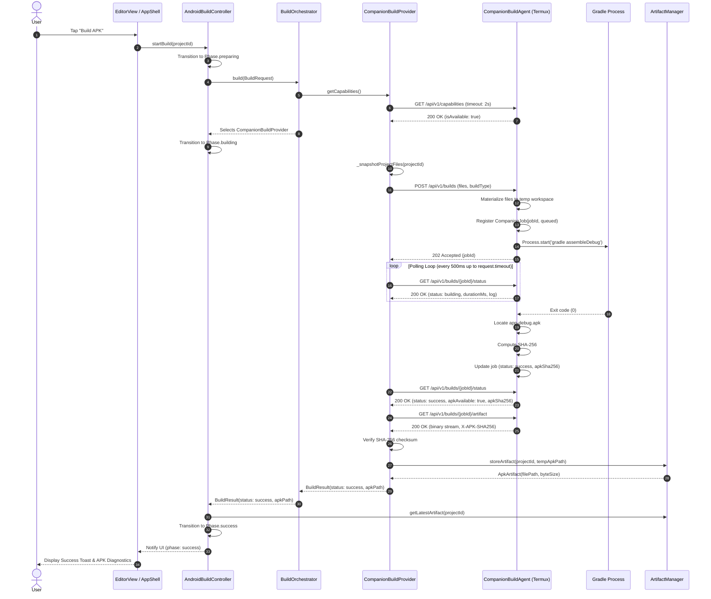

# Nomad Android Lab — Architecture & Lifecycle Audit
**Document ID:** AL-4-AUDIT-01  
**Sprint Classification:** Reliability Engineering, Root Cause Analysis, Lifecycle Hardening  
**Target Baseline:** AL-3 (commit `1872ae3`)  
**Status:** Completed  

---

## 1. System Overview & Component Inventory

Nomad Android Lab enables on-device and workstation-hosted compilation of Kotlin / Jetpack Compose Android applications. The system consists of two primary operational domains:

1. **Nomad Mobile (Flutter Application)**:
   - `AndroidBuildController` (`apps/nomad_mobile/lib/android_build/android_build_controller.dart`): State coordinator managing lifecycle phases (`idle`, `preparing`, `building`, `cancelling`, `success`, `failure`, `timeout`, `cancelled`), build results, and UI reactivity.
   - `BuildOrchestrator` (`apps/nomad_mobile/lib/android_build/providers/build_orchestrator.dart`): Provider router that queries capabilities across registered providers (`LocalHostBuildProvider`, `CompanionBuildProvider`) and selects the optimal active provider.
   - `CompanionBuildProvider` (`apps/nomad_mobile/lib/android_build/providers/companion_build_provider.dart`): Client for the Termux Companion Daemon on `http://127.0.0.1:8089`. Handles project snapshots, build submission, status polling, artifact streaming, and SHA-256 verification.
   - `LocalHostBuildProvider` (`apps/nomad_mobile/lib/android_build/providers/local_host_build_provider.dart`): Executes builds on desktop hosts via local Gradle CLI.
   - `ArtifactManager` (`apps/nomad_mobile/lib/android_build/artifact_manager.dart`): Persists and indexes APK artifacts in `$TEMP/nomad_builds/<projectId>`, maintaining version history and retention pruning.
   - `EditorView` (`apps/nomad_mobile/lib/ui/editor_view.dart`): Kotlin/Gradle source editor featuring the build trigger button and build diagnostics modal.
   - `AppShell` (`apps/nomad_mobile/lib/app/app_shell.dart`): Root navigation shell orchestrating project selection, controller lifecycle, and snackbar/error toasts.

2. **Companion Build Agent (Termux / Linux Daemon)**:
   - `CompanionBuildAgent` (`experiments/android_lab_on_device/companion_agent/agent.dart`): HTTP server running on `127.0.0.1:8089`. Materializes project files, spawns `gradle assembleDebug`, streams logs, captures exit codes, calculates artifact checksums, and serves APK binaries.

---

## 2. End-to-End Build Lifecycle Sequence



---

## 3. Initial Failure Register & Weakness Matrix

| ID | Component | Defect / Vulnerability | Manifestation | Severity |
| --- | --- | --- | --- | --- |
| **F-01** | `CompanionBuildProvider` | Unbounded `req.close()` and `utf8.decodeStream()` in HTTP operations. | If socket connects but server stalls or drops headers, provider hangs indefinitely without triggering timeout. | **Critical** |
| **F-02** | `agent.dart` | SHA-256 calculation hardcoded to `job.apkSha256 = '_'`. | Flutter client computes real SHA-256, detects mismatch with `'_'`, throws `StateError`, catches and returns `null` APK path, failing artifact ingestion. | **Critical** |
| **F-03** | `CompanionBuildProvider` / `AndroidBuildController` | No progress or stage event propagation during long-running builds (1–5 min). | UI displays an uninformative loading spinner with static status message `"Compiling Android APK..."`, giving the impression of an unresponsive hang. | **High** |
| **F-04** | `agent.dart` | `proc.stdout` and `proc.stderr` string buffer concatenation on every data chunk. | Under heavy Gradle log volume, repeatedly concatenating full strings creates $O(N^2)$ memory allocations in Dart VM, stalling event loop. | **High** |
| **F-05** | `EditorView` | Lack of build cancellation button or cancel trigger in editor UI while `isBusy == true`. | User cannot abort a slow or stuck build from the editor toolbar; must wait for full timeout. | **Medium** |
| **F-06** | `agent.dart` | Standalone execution in Termux lacked `pubspec.yaml` declaring `crypto` package. | Running `agent.dart` with standard `package:crypto` was impossible without manual pub package setup. | **Medium** |
| **F-07** | `CompanionBuildProvider` | Error swallowing in `_downloadAndStoreArtifact` (`catch (_) { return null; }`). | Artifact transfer errors fail silently instead of propagating explicit diagnostics to `BuildResult`. | **Medium** |

---

## 4. Reproduction & Isolation Protocol

### Reproduction Scenario 1: SHA-256 Integrity Rejection

1. Trigger build via `CompanionBuildProvider` with active `CompanionBuildAgent`.
2. Gradle completes compilation with exit code `0` and produces `app-debug.apk`.
3. Agent returns `apkSha256: "_"`.
4. Provider receives success status, downloads APK, computes actual SHA-256 (64 hex characters).
5. Provider fails checksum comparison (`actual != "_"`), deletes downloaded APK, returns `apkPath: null`.
6. UI shows `"APK build succeeded"` toast, but artifact is missing and cannot be opened or deployed.

### Reproduction Scenario 2: Unbounded Socket Close Hang

1. Start a mock server or loopback daemon that accepts TCP connections on `8089` but does not flush HTTP headers or terminate response streams.
2. Trigger `startBuild()`.
3. `httpClient.getUrl(...)` succeeds immediately, but `await req.close()` hangs forever because no timeout was applied to the `close()` future.
4. `AndroidBuildController.isBusy` remains `true` indefinitely.

```